# FocusFence extension: concepts

- **Round 4** (near the end): the owner's own decision, an abstract fence of frosted-glass pills, and how it maps onto real data. **Round 5** brings its proportions and floor closer to the owner's references.
- **Round 3** (below the round 2 decision): four ways to draw the fence itself, and the choice.
- **Round 2**: three concepts for the whole UI, and the choice of "the living fence".

## Round 2: three concepts

The first redesign (pass 1–4 in `BRIEF.md`) restyled the existing layouts. The owner's verdict: it reads as a recolour. This round starts again from the feature list, not the screens:

- **Free features:** a blocklist (sites and subdomains), one-click "Block site", an on/off switch, the block page with a quote and today's count, host access, and onboarding.
- **Pro features:** paths and keywords, schedules, focus sessions, strict mode, password lock, a custom block-page message, stats, and backup.
- **Around them:** the plan and payments, the lock screen, and the Incognito warnings.

Three genuinely different directions were sketched as quick mockups (`concepts/*.html`, rendered to `concepts/*.png`). The tokens are the same as in round 1, which the owner liked. What changes is structure, interaction and the signature element.

### Concept A — The living fence

**Thesis.** Your blocklist is a fence. Every site you block becomes a picket, drawn with the logo's 45° tip and its monogram, and the fence's posture is the state:
- up and lit while blocking;
- lowered when off;
- half-lowered when the schedule pauses it;
- amber and locked in strict mode;
- glowing, with its lower rail filling up, during a focus session.

The same object appears everywhere, so the brand stops being decoration and becomes the product's data.

- **Popup.** The fence of your own sites is the status, readable in two seconds: lit, six pickets, so you're protected and six sites are fenced. Below it is one big action for the tab you're on ("Block site", full width), then a typed add field. Focus collapses to one line until it runs; then the timer takes over and the fence's lower rail fills as the round progresses.
- **Block page.** The screen people see most becomes a scene. A fence stands across the horizon, silhouetted against a green light, and the picket for the site you just tried is the lit one. The fence rises in a wave from that picket when the page opens; the headline dims the distraction.
- **Settings.** Five destinations in a top bar instead of nine sections in a sidebar: Blocklist, Focus, Strict, Stats, Plan. The on/off switch moves into the bar, because it's global state, not a blocklist detail.
  - The Blocklist opens on your fence, drawn large and lettered.
  - Pro destinations open on a preview with real prices for Free users, instead of a stack of disabled controls.
- **Onboarding.** "Build your fence". Three empty slots wait on a stage; each site you pick rises into one. Step 2 shows a normal and an Incognito window to explain the gap. Step 3 shows the finished fence lit.

**Risks.**
- Metaphor overload: the fence must be the one ornament, never a theme.
- Long lists: the fence summarises (+N) instead of growing forever.
- Motion must stay calm. It runs once per change, never loops, and is off with reduced motion.

### Concept B — Command

**Thesis.** FocusFence as a keyboard-first utility, in the Raycast mould.
- The popup is a command bar: type a site to fence it, or arrow through actions (block this tab, start focus, turn off, strict mode) with keycaps.
- Settings are a dense two-pane preference window.
- The block page is one quiet monospace line with keyboard hints.

**Strengths.** Fastest for power users. Scales to many commands. Distinctive among blockers.

**Risks.**
- Popup shortcuts collide with Chrome's own, and Enter-to-block on open invites accidental blocks, which strict mode then makes permanent.
- Most people who install a site blocker are not keyboard users.
- The block page is the emotional moment, and this concept makes it the coldest screen.
- It expresses Raycast more than FocusFence: nothing ties it to the fence or the Picket F.

### Concept C — Day

**Thesis.** Focus is about time, so organise everything around today, in the calm of Things.
- The popup leads with a 24-hour ribbon: protected windows, where you are now, and dots where you reached for a distraction. "Protected until 12:30" is the headline.
- The block page tells the time ("10:42 · protected until 12:30").
- Settings become a week planner.

**Strengths.** Makes schedules tangible. Beautiful for people who plan their days.

**Risks.**
- Schedules are Pro, so for every Free user the ribbon is empty and the hero of the product says nothing.
- The core free feature, the list of sites, becomes secondary.
- A week planner wants drag-to-edit, which is a new feature, not a redesign.

### Decision: A, with the best of B and C

**The living fence** is the strongest.

1. **It is the only concept that is about FocusFence.** The name, the Picket F logo and the website's closing fence become one object that is also real data: your sites. Neither a command bar nor a time ribbon could carry another brand's name and still look right.
2. **It works for every user on day one.** Free users have a fence the moment they block a site. Pro features change the fence's posture (scheduled, focusing, locked), so upgrades extend the same picture instead of adding screens.
3. **It turns the most-seen screen into a moment.** Hitting your own fence, with your site's picket lit, is calm, a little poetic and unmistakable, without guilt or alarm.
4. **It answers the two-second test** for the popup: lit fence plus one big button.
5. **It is honest about state.** Up, lowered, half-lowered, amber and filling are five readable postures. Text still says everything, for screen readers and for anyone who prefers words.

Borrowed from the others:
- **From C:** time is made visible where it matters. The schedule is drawn as a week ribbon above its editor, and strict mode and pauses say "until …".
- **From B:** typed entry everywhere (Enter adds), quiet keyboard affordances, and no autofocus on destructive actions.

The build, its system and its critique passes are documented in `BRIEF.md` (round 2).

## Round 3: the fence itself

The owner's verdict on round 2: "Much better overall, but the fence itself is ugly, it needs a redesign." The idea stays (one picket per site with its initial, your site's picket lit on the block page); the drawing goes, from the white picket fence of the block page to the flat pentagons of the popup.

**Why it looked like clip-art:**
1. A uniform row of identical flat shapes across the whole window: a barcode.
2. Opaque rails across the full width, overhanging the ends like ladder rungs.
3. Flat fills: no light, no material, no ground. The fence floated, cut off by the window's edge.
4. In light, white pickets with a hairline shadow: the stock suburban illustration.
5. Initials at the foot of the picket, hidden as soon as the fence sank.

### Four directions

Each was drawn into the real block page (same copy, buttons and type; only the scene is swapped) in light and dark, and at popup size (2x), where the fence is seen most. Sources: `concepts/fence/` (`directions.js`, `capture.mjs`); renders: `screenshots/fence-explorations/`.

**A. Lantern — soft depth.** Slender pickets with a material: a body that darkens toward the ground, a tip cut in two facets, a shaded right face, a 1 px edge light. The site's picket is a lantern: lit from within, it rims its neighbours, lights the rails near it, pools on the ground and is reflected in it.

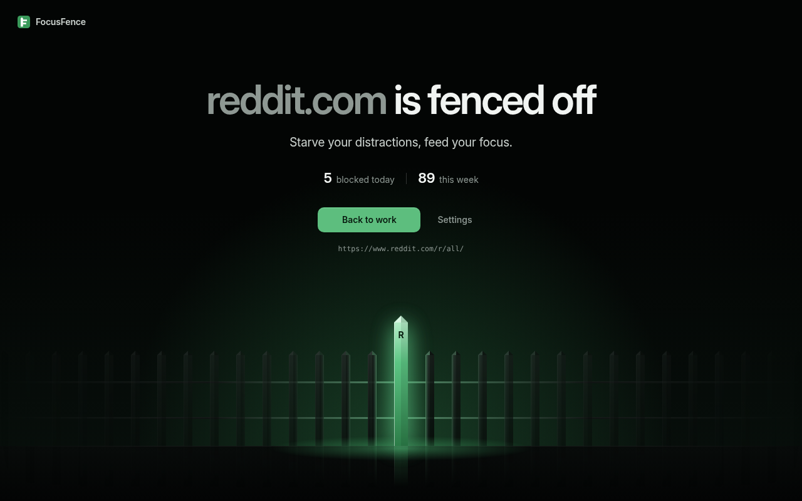
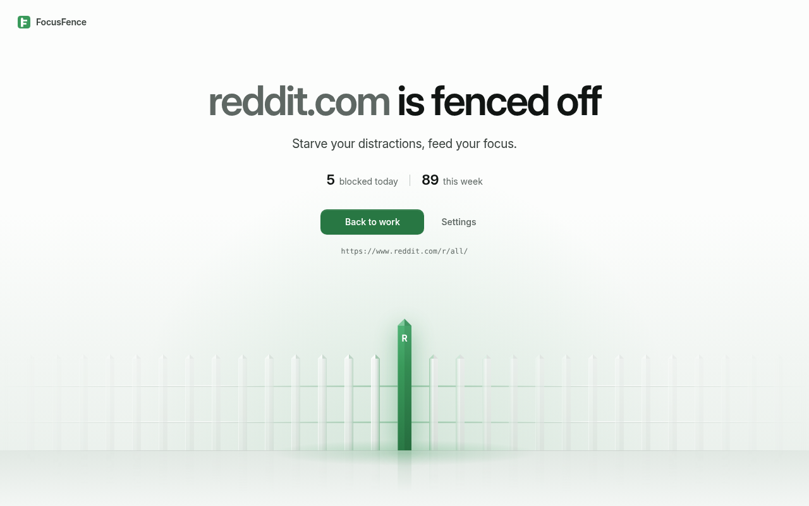
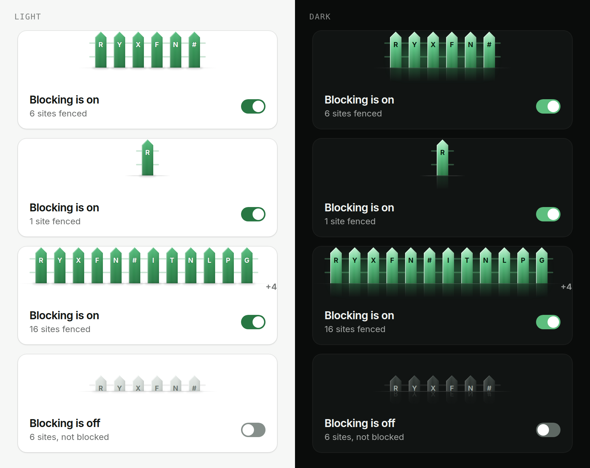

**B. Hairline — line art.** The fence drawn with 1.25 px strokes, the rails broken around each picket. The lit picket is the only solid shape, echoed by two outlines and a dotted third, like a signal.

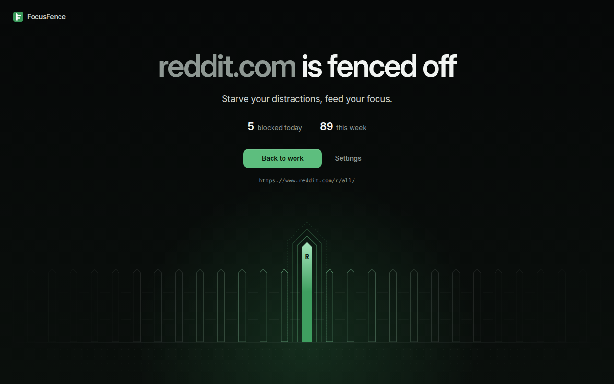
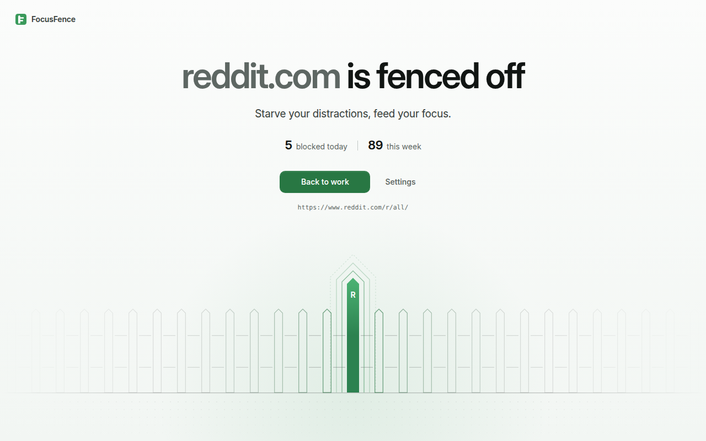
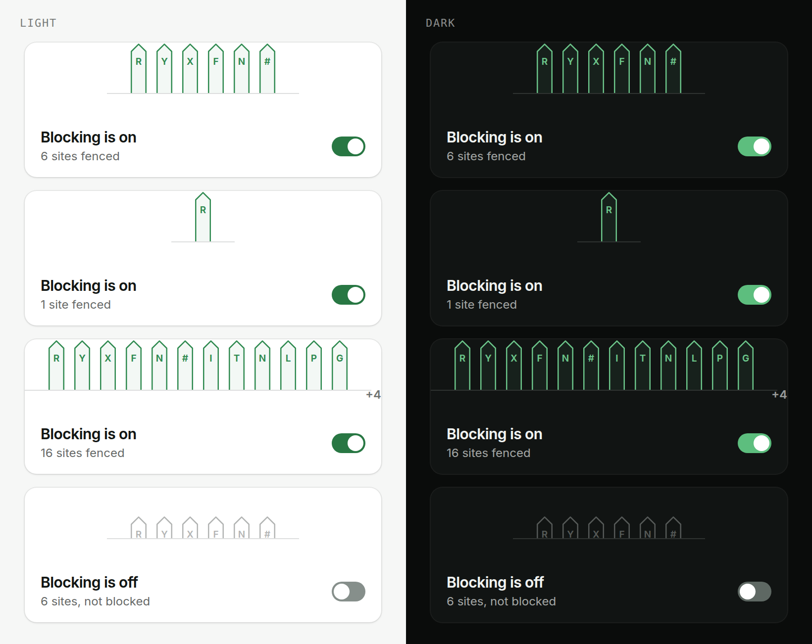

**C. Extruded — 2.5D.** Pickets with real thickness in an oblique projection (front face true to shape, so the initials stay crisp; bevel and side flat-shaded), rails as beams behind them.

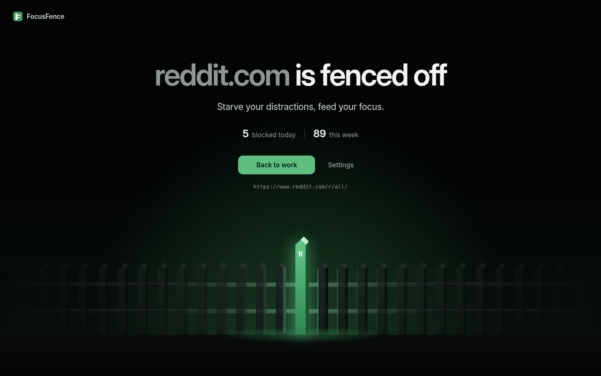
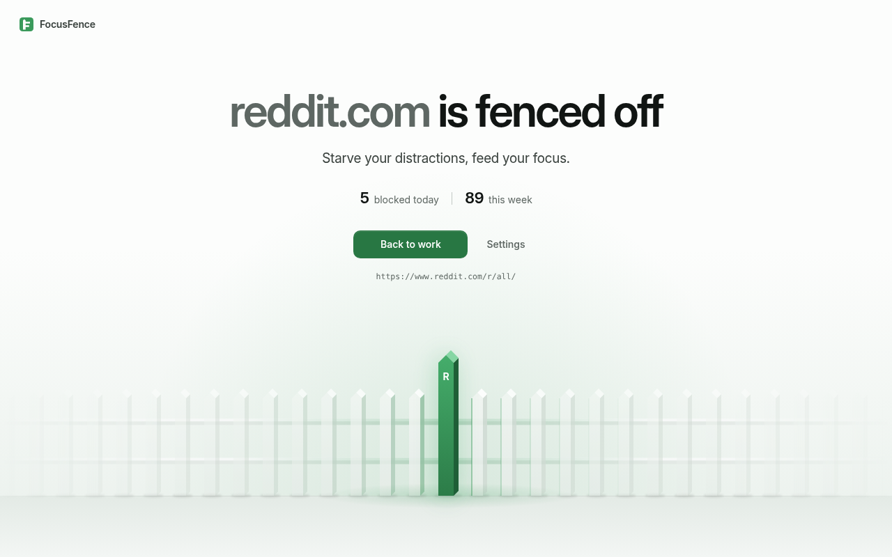
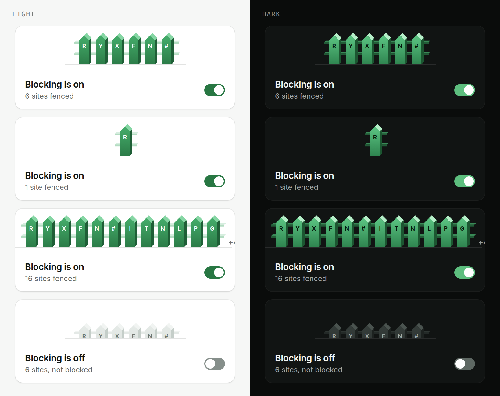

**D. Horizon — layered silhouettes.** Three fences receding into haze, a landscape, the lit picket in the front row.

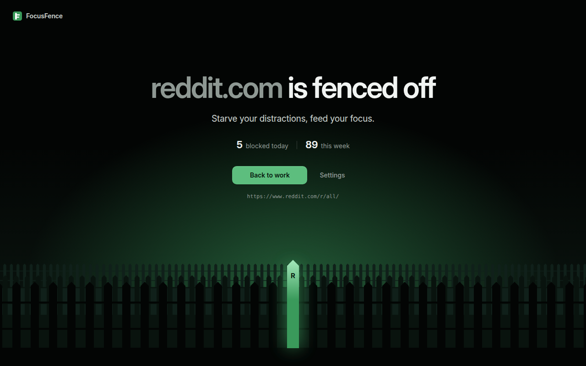
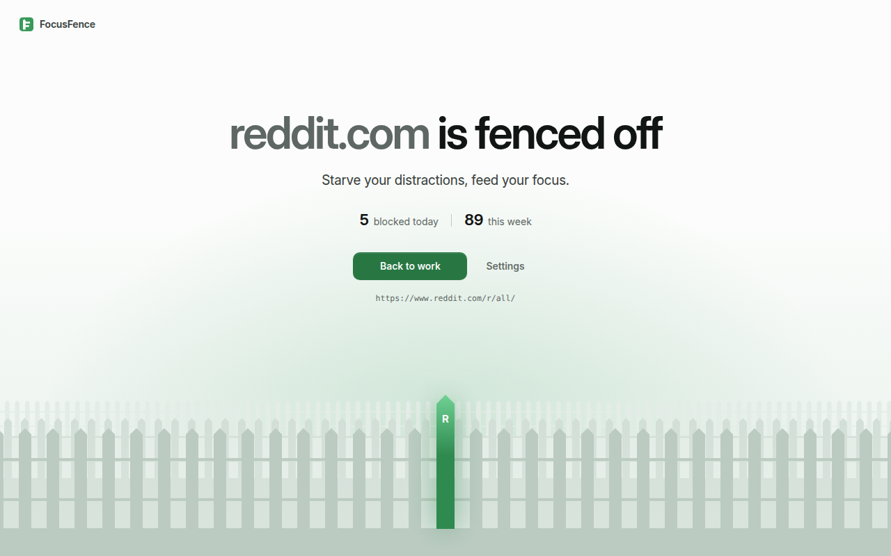
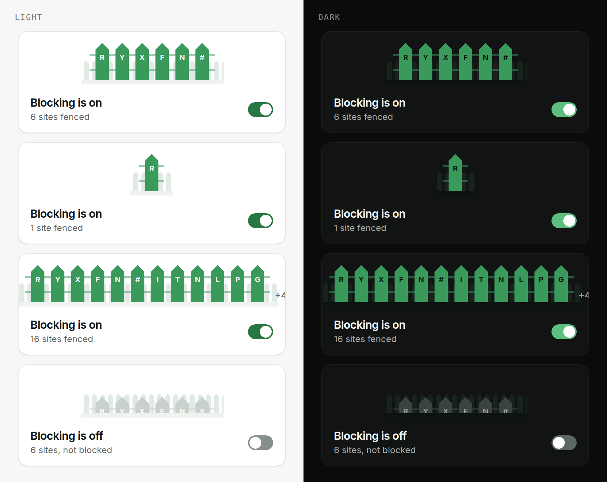

The first pass of all four repeated round 2's mistake: a dense row across the whole window. The second pass (shown) uses slimmer pickets with wider gaps (14 px, 28 px apart), lets the fence fade away from the lit picket, and lights the rails only near it.

### Honest comparison

| | Block page, dark | Block page, light | Popup scale | Verdict |
|---|---|---|---|---|
| **A. Lantern** | The strongest image of the four: a calm night scene, the lit picket the light source | First take (misty white) still read as a white fence; fixed by a study (below) | Each picket becomes a small lantern: jewel green in light, a blade of light in dark | **Chosen** |
| **B. Hairline** | Refined and very calm; the echoed outline is a lovely motif | Clean, never clip-art | The fence becomes a row of outlined tags; the rails between them read as minus signs. An "on" fence would have to be filled, which brings back the flat pickets | Runner-up; its outline is kept for empty slots |
| **C. Extruded** | Crafted, like a 3D icon | Reads as a 3D white picket fence, the very thing to remove | Chunky toy blocks | Rejected |
| **D. Horizon** | Three rows triple the barcode | Heavy and grey | Cluttered | Rejected after the first pass |

**The light theme of the lantern.** Two studies on top of the first take:
- **Glass:** translucent white pickets. Pretty, but still white pickets.
- **Dawn:** sage pickets, backlit at dawn: soft stone rather than painted wood. Chosen.

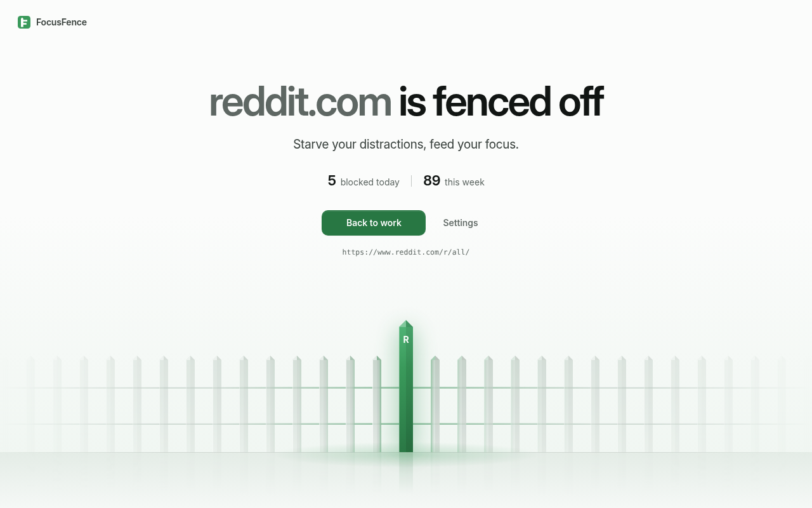
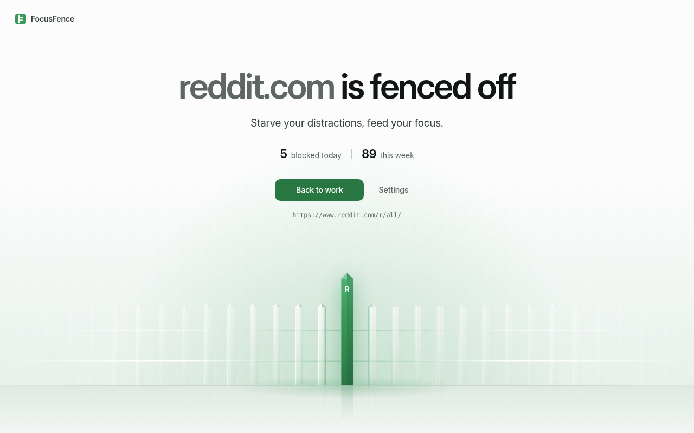

### Decision: the lantern, with Hairline's outline

1. **The fence is made of light, and light is the state.** While blocking is on, your pickets hold the light; turned off, they go dark and sink; the site you just tried is the brightest thing on the screen. The brand already speaks this way: the website ends on a fence silhouetted against green light, and the logo is a lit picket.
2. **It is the only direction that is premium in both themes and at both scales**, from a 16 px picket in the popup to the full-width scene.
3. **The highlighted picket stands out without alarm.** It doesn't shout in red; it is the scene's light source.
4. **It scales.** One site is a single lit post; many sites are a lit fence with a "+N" beside it; an empty list is a row of outlined slots.
5. **It is plain CSS.** Gradients, `clip-path` and a reflection built through the CSSOM: no images, no canvas, and no inline styles, which the extension's CSP forbids.

**Borrowed from the others:**
- **From Hairline:** an empty slot is the picket's outline, open at the ground. It appears in the empty popup and Blocklist, in onboarding's waiting slots and in the Incognito window that isn't covered yet.
- **From Horizon:** atmospheric falloff. The wall fades into haze (dawn) or darkness (night) away from the lantern.

The build and its critique passes are in `BRIEF.md` (round 3).

## Round 4: the owner's direction, glass pills

The owner generated AI reference renders and picked an **abstract** direction for the fence. Its description, in short:
- **Dark:** near-black with a deep green tint, fading to pure black at the top; a short row of 7–9 wide pills (rectangles with a full semicircle top, about 110 px wide and 10 px apart, no rails, no points), the tallest in the middle and the others stepping down like a bell. The pills are frosted, faintly emissive glass with a brighter rim along the top. The middle pill is the light: bright emerald, glowing from inside, with a volumetric halo behind it, lighting its neighbours (green nearby, grey-green farther out), over a glossy floor with a soft reflection and a pool of light. The top half stays empty for the words.
- **Light:** warm paper (`#F7F8F5`), the same row in milky frosted glass, very pale sage, greener toward the middle; the middle pill solid saturated green (`#1E8A45`) with a soft bloom; a subtle reflection; airy.

The idea of rounds 2 and 3 survives intact (one element per blocked site, your site lit); the drawing becomes the owner's.

### From a picture to data

The reference is a single composition. The fence is data, so it needs rules:

| The reference shows | Rule |
|---|---|
| 7–9 pills | one pill per blocked site, at least 5 (spare pills are fainter) and at most 7 on the block page and in the popup, 9 in Settings (round 5; round 4 allowed 11); always odd, so the bell stays symmetrical. Beyond the maximum, the words carry the count |
| the middle pill lit | the site you tried (block page), the site on this tab or your newest (popup), your newest (Settings), your first pick (onboarding) |
| heights stepping down like a bell | `k = 0.575 + 0.425 · cos²(π · d / 2m)` since round 5: the ends always 0.575 of the middle, for any count |
| neighbours tinted by the light | each pill catches `t = e^(−d / 1.25)` of the light, on the side that faces it |
| the ends fading | the last two pills show at 92 % and 60 % (round 5; round 4 faded them to 45 %) |
| a compact row, never a barcode | the row is at most 1000 px wide on the block page; since round 5, more sites mean fewer pills shown, not thinner ones |
| the top half empty for the text | the words keep their room at every window size; the fence shrinks rather than meet them |
| the light's halo | a volumetric column in dark; a soft bloom in light, where a tall column would read as a stain (the round 2 lesson) |

States are light, as before: no light (and sunk pills) when blocking is off or paused, amber light in strict mode, outlines for an empty fence. The site's initial stays on the lit pill, small and white near the top, as the brief allows.

### Applied everywhere

- **Block page:** the composition itself, the fence and its reflection on a glossy floor.
- **Popup:** the same row, compact (26 px pills).
- **Settings:** the Blocklist header (40 px pills), the block-page miniature, the Plan view (an amber light for the offer, green once you have Pro) and the stats chart (today's bar holds the light).
- **Onboarding:** five pills since round 5 (seven in round 4), the three in the middle are yours: outlines that fill as you pick sites, the first one lit. The Incognito window's fence is outlines until FocusFence is allowed there; step 3 adds an amber pill with a lock.

Renders: `screenshots/block-light.png` and `screenshots/block-dark.png`, and every state in `screenshots/`. The build and its critique passes are in `BRIEF.md` (round 4).

## Round 5: closer to the references

A side-by-side review against the owner's renders found round 4's pills too slender: they read as tall windows, not soft glass pebbles. The references, measured:

| | Reference | Round 4 | Round 5 |
|---|---|---|---|
| middle pill, width : height | about 1 : 1.6 | 1 : 2.7 | 1 : 1.6 |
| end pills, width : height | about 1 : 0.9 | 1 : 1.45 | 1 : 0.92 |
| middle ÷ end height | about 1.7 | 1.9 and more | 1.74, for any count |
| gap | 8–10 % of a pill | 9 % | 9 % |
| floor | glossy, every pill mirrored faintly, a light pool | a band, little reflection | seamless, every pill mirrored |
| end pills (light) | clearly visible milky glass | almost invisible | about two thirds of their neighbour |

To keep the row within 1000 px with wider pills, the block page shows fewer of them rather than thinner ones (7 at most). The rule from round 4 stands: one pill per site, the current site lit, the words carry the count.
