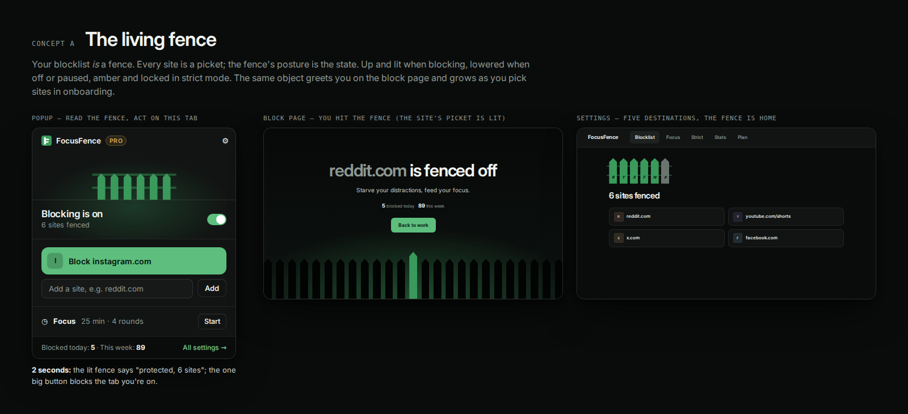
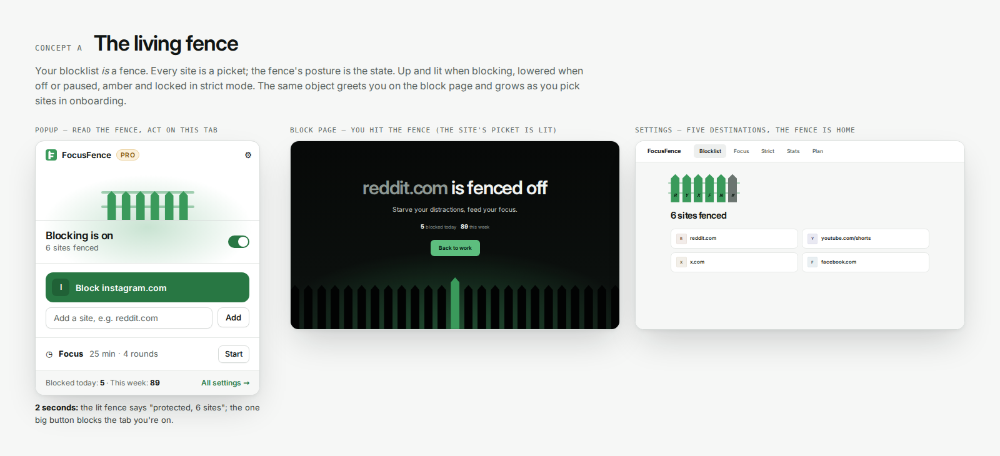
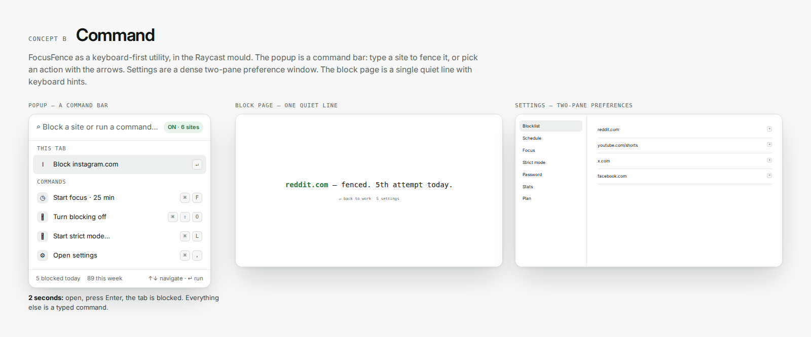
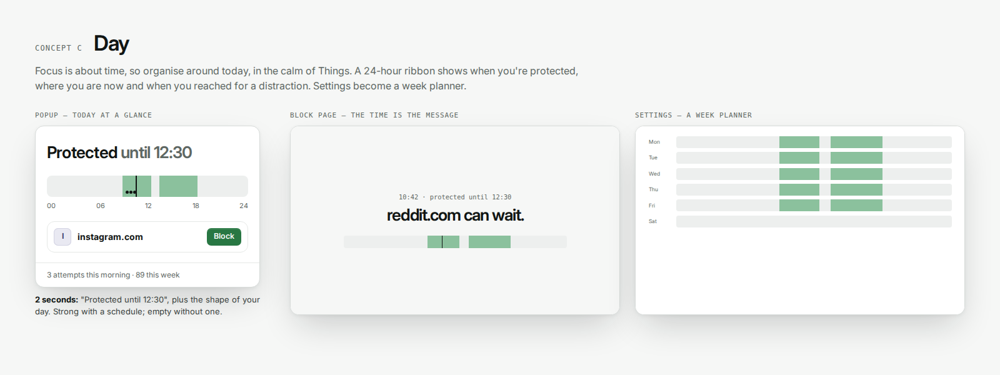

# FocusFence extension: three concepts

The first redesign (pass 1–4 in `BRIEF.md`) restyled the existing layouts. The owner's verdict: it reads as a recolour. This round starts again from the feature list, not the screens:

- **Free features:** a blocklist (sites and subdomains), one-click "Block site", an on/off switch, the block page with a quote and today's count, host access, and onboarding.
- **Pro features:** paths and keywords, schedules, focus sessions, strict mode, password lock, a custom block-page message, stats, and backup.
- **Around them:** the plan and payments, the lock screen, and the Incognito warnings.

Three genuinely different directions were sketched as quick mockups (`concepts/*.html`, rendered to `concepts/*.png`). The tokens are the same as in round 1, which the owner liked. What changes is structure, interaction and the signature element.

## Concept A — The living fence

**Thesis.** Your blocklist is a fence. Every site you block becomes a picket, drawn with the logo's 45° tip and its monogram, and the fence's posture is the state:
- up and lit while blocking;
- lowered when off;
- half-lowered when the schedule pauses it;
- amber and locked in strict mode;
- glowing, with its lower rail filling up, during a focus session.

The same object appears everywhere, so the brand stops being decoration and becomes the product's data.

- **Popup.** The fence of your own sites is the status, readable in two seconds: lit, six pickets, so you're protected and six sites are fenced. Below it is one big action for the tab you're on ("Block site", full width), then a typed add field. Focus collapses to one line until it runs; then the timer takes over and the fence's lower rail fills as the round progresses.
- **Block page.** The screen people see most becomes a scene. A fence stands across the horizon, silhouetted against a green light, and the picket for the site you just tried is the lit one. The fence rises in a wave from that picket when the page opens; the headline dims the distraction.
- **Settings.** Five destinations in a top bar instead of nine sections in a sidebar: Blocklist, Focus, Strict, Stats, Plan. The on/off switch moves into the bar, because it's global state, not a blocklist detail.
  - The Blocklist opens on your fence, drawn large and lettered.
  - Pro destinations open on a preview with real prices for Free users, instead of a stack of disabled controls.
- **Onboarding.** "Build your fence". Three empty slots wait on a stage; each site you pick rises into one. Step 2 shows a normal and an Incognito window to explain the gap. Step 3 shows the finished fence lit.

**Risks.**
- Metaphor overload: the fence must be the one ornament, never a theme.
- Long lists: the fence summarises (+N) instead of growing forever.
- Motion must stay calm. It runs once per change, never loops, and is off with reduced motion.

## Concept B — Command

**Thesis.** FocusFence as a keyboard-first utility, in the Raycast mould.
- The popup is a command bar: type a site to fence it, or arrow through actions (block this tab, start focus, turn off, strict mode) with keycaps.
- Settings are a dense two-pane preference window.
- The block page is one quiet monospace line with keyboard hints.

**Strengths.** Fastest for power users. Scales to many commands. Distinctive among blockers.

**Risks.**
- Popup shortcuts collide with Chrome's own, and Enter-to-block on open invites accidental blocks, which strict mode then makes permanent.
- Most people who install a site blocker are not keyboard users.
- The block page is the emotional moment, and this concept makes it the coldest screen.
- It expresses Raycast more than FocusFence: nothing ties it to the fence or the Picket F.

## Concept C — Day

**Thesis.** Focus is about time, so organise everything around today, in the calm of Things.
- The popup leads with a 24-hour ribbon: protected windows, where you are now, and dots where you reached for a distraction. "Protected until 12:30" is the headline.
- The block page tells the time ("10:42 · protected until 12:30").
- Settings become a week planner.

**Strengths.** Makes schedules tangible. Beautiful for people who plan their days.

**Risks.**
- Schedules are Pro, so for every Free user the ribbon is empty and the hero of the product says nothing.
- The core free feature, the list of sites, becomes secondary.
- A week planner wants drag-to-edit, which is a new feature, not a redesign.

## Decision: A, with the best of B and C

**The living fence** is the strongest.

1. **It is the only concept that is about FocusFence.** The name, the Picket F logo and the website's closing fence become one object that is also real data: your sites. Neither a command bar nor a time ribbon could carry another brand's name and still look right.
2. **It works for every user on day one.** Free users have a fence the moment they block a site. Pro features change the fence's posture (scheduled, focusing, locked), so upgrades extend the same picture instead of adding screens.
3. **It turns the most-seen screen into a moment.** Hitting your own fence, with your site's picket lit, is calm, a little poetic and unmistakable, without guilt or alarm.
4. **It answers the two-second test** for the popup: lit fence plus one big button.
5. **It is honest about state.** Up, lowered, half-lowered, amber and filling are five readable postures. Text still says everything, for screen readers and for anyone who prefers words.

Borrowed from the others:
- **From C:** time is made visible where it matters. The schedule is drawn as a week ribbon above its editor, and strict mode and pauses say "until …".
- **From B:** typed entry everywhere (Enter adds), quiet keyboard affordances, and no autofocus on destructive actions.

The build, its system and its critique passes are documented in `BRIEF.md` (round 2).
