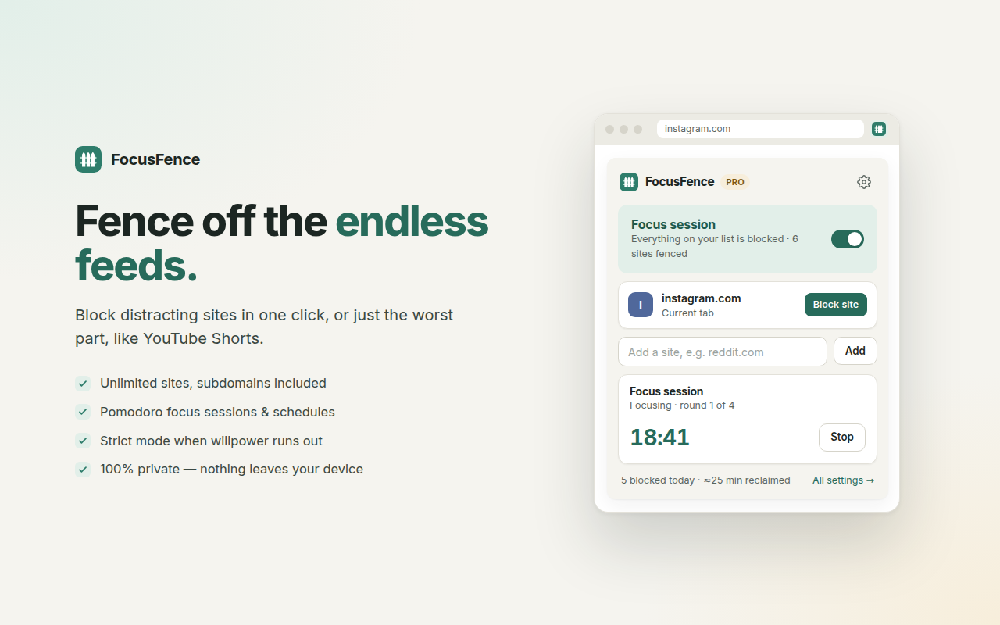

# FocusFence

A calm, private, freemium **Chrome extension (Manifest V3)** that blocks distracting websites.

| Free | Pro ($2.99/month or $19.99/year) |
|---|---|
| Unlimited blocked sites | Schedules (days + time ranges, overnight supported) |
| Domain blocking incl. subdomains (`reddit.com` → `old.reddit.com`, `m.youtube.com`, …) | Path & keyword blocking (`youtube.com/shorts` only) |
| One-click "Block site" for the current tab | Pomodoro focus sessions |
| On/off switch | Strict mode (10-minute cooling-off + typing challenge to end early) |
| Block page with quote + time reclaimed | Password lock · Stats · Custom block-page message · JSON export/import |

No backend, no analytics; nothing leaves the device except ExtensionPay license checks after a user starts an upgrade.



## Layout

```
src/                  the extension (load this folder unpacked)
  manifest.json
  background.js       service worker: rule sync, timers, licensing, message API
  lib/core.js         pure logic (parsing, matching, schedules, DNR rule builder, stats)
  lib/ui.js           shared page helpers
  popup.*  options.*  blocked.*   UI
  spa-guard.js        tiny content script for path rules on single-page apps
  config.js           DEV flag + ExtensionPay id (placeholder 'focusfence')
  vendor/ExtPay.js    ExtensionPay library (copied from node_modules/extpay)
tests/                Playwright: core unit tests + e2e in headless Chromium
scripts/              build, screenshots, icons, test launcher
store/                privacy policy + Chrome Web Store listing
screenshots/          UI shots, 1280×800 store screenshots, 440×280 promo tile
dist/                 focusfence-<version>.zip (store package)
```

## How blocking works

- Every change re-computes **declarativeNetRequest dynamic rules**:
  - all domain entries collapse into **one** rule (`requestDomains` matches subdomains), redirecting to `blocked.html#<original-url>` via `regexSubstitution`;
  - each path/keyword entry gets its own regex rule.
- Chrome only allows **redirect** rules on hosts the extension has access to. Rather than asking for `<all_urls>`, FocusFence requests **optional host access per site** when the user adds it. Until granted (or if declined) the site is still blocked with a plain `block` rule (Chrome's error page).
- Path rules on SPAs (YouTube) are also enforced on in-app navigation by `spa-guard.js`, registered dynamically only on granted hosts that have path rules.
- `chrome.alarms` drives schedule boundaries (1-minute tick), Pomodoro phase changes, timed strict mode and a 12-hourly license refresh.
- The service worker is the single source of truth: Pro gating, strict mode and the password lock are enforced there, not just in the UI.

## Pro / payments

`src/config.js`:

```js
DEV: true,              // build flips this to false
EXTPAY_ID: 'focusfence' // placeholder — replace with your ExtensionPay extension id
```

- `DEV: true` → "Simulate Pro" switch in Settings → Plan; **no** ExtensionPay network calls.
- `DEV: false` → real `extpay.getUser()` / `openPaymentPage()`; `extpay.onPaid` unlocks Pro immediately.

## Develop

```bash
npm install
npx playwright install chromium
# load ./src as an unpacked extension in chrome://extensions (Developer mode)
```

## Test

```bash
npm test            # 69 tests (unit, e2e, axe accessibility, store checks): core unit tests + e2e + production-build smoke test
```

The e2e suite launches Playwright's Chromium (new headless) with the unpacked extension and routes all traffic through a local "fake internet" proxy (TLS terminated with a throwaway self-signed cert, so HSTS-preloaded hosts such as reddit.com work). Headless Chromium cannot click Chrome's permission prompt, so the test copy of the extension gets host access up front; one test uses the real manifest to verify the no-access fallback.

If Chromium is missing system libraries and you cannot `sudo`, extract them locally and point `FF_CHROME_LIBS` at the folder:

```bash
FF_CHROME_LIBS=/path/to/libs npm test
```

## Build & assets

```bash
npm run build        # dist/focusfence/ + dist/focusfence-1.0.0.zip (DEV=false)
npm run screenshots  # screenshots/*.png
npm run icons        # src/icons/*.png
```

## Website (GitHub Pages)

`npm run docs` regenerates `../docs/` (repo root): landing page + `privacy.html`, rendered from `store/privacy-policy.md`. Serve it with GitHub Pages from branch `main`, folder `/docs`.

## License

FocusFence is licensed under the **GNU AGPL v3 or later** (`LICENSE`).

Why: the ExtensionPay client (`extpay`) declares `AGPL-3.0-or-later` in its package.json and source header, while its LICENSE file says `LGPL-3.0`. Shipping it inside the extension makes the package a combined work. The cleanest option that complies with either reading is to license FocusFence itself under AGPL-3.0-or-later:

- `src/vendor/ExtPay.js` is byte-for-byte `extpay@3.1.2/dist/ExtPay.js` (checked by `tests/build.spec.mjs`);
- `LICENSE`, `THIRD_PARTY_NOTICES.txt` and `licenses/` ship inside the zip;
- the zip contains the complete, unminified source (the Corresponding Source), and Settings → Plan links the license, notices and source repository.

Alternatives considered: "load extpay from npm as-is with a notice" doesn't avoid copyleft, because the library is still distributed inside the extension. A clean-room payment client against ExtensionPay's HTTP API would allow a proprietary license, but it is riskier and has to be maintained by hand. Not legal advice. Have counsel confirm before launch.

Third-party: ExtPay (AGPL-3.0-or-later), webextension-polyfill 0.7.0 bundled inside it (MPL-2.0), Inter font (SIL OFL 1.1). See `src/THIRD_PARTY_NOTICES.txt`.

## Strict mode limits

Chrome always lets users disable or remove extensions, and no extension can block `chrome://extensions`. Mitigations: timed strict sessions pause while FocusFence isn't running (heartbeat every minute, so disabling it can't run out the clock), and the options page and popup warn when FocusFence isn't allowed in Incognito. The limits are documented in the UI, the listing and the landing page FAQ.
